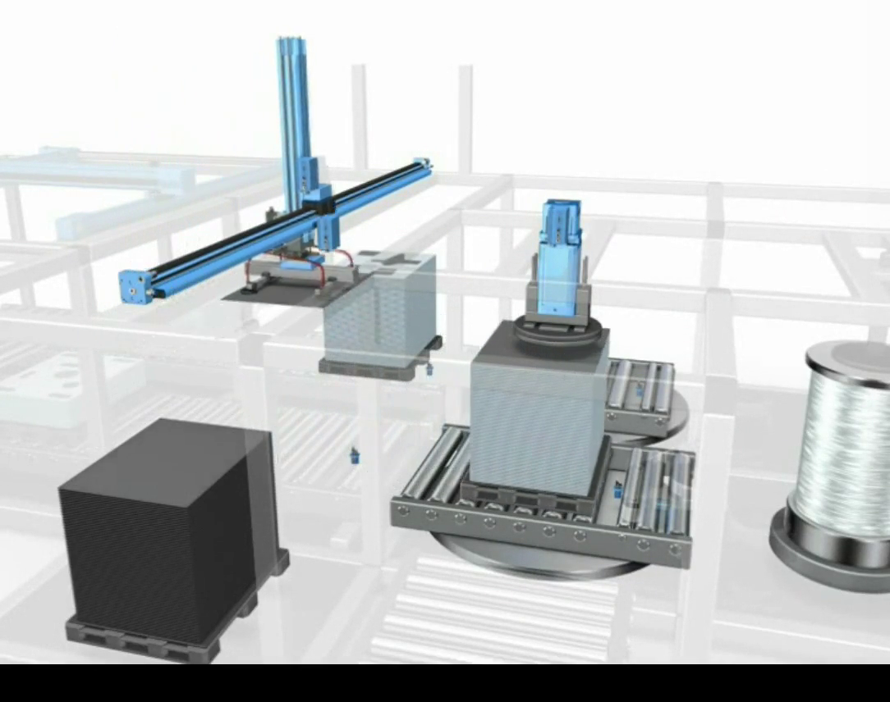
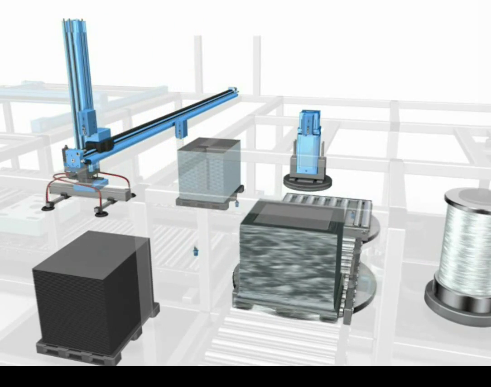

# Automated Glass Packaging — Industrial PLC Control

A PLC-based industrial automation project that models a glass-packaging workflow with **conveyors, a vacuum-sheet handling manipulator, rotating transfer stations, sensors, and sequential control**. The project coordinates the placement of a thin metal protective sheet over a glass assembly and its subsequent transfer through a packaging line.

Developed by **Ahmad Mansour** and **Lawrence Abou Karroum** at the **University of Balamand** (Department of Mechatronics, 2024).

## Process demonstration

[](media/glass-packaging-demo.mp4)

**[Watch the 41-second packaging-process animation (MP4)](media/glass-packaging-demo.mp4)**

The recording illustrates the glass-handling and conveyor process. It is a visual process demonstration; it should not be interpreted as proof that the PLC program was independently executed against the animation.

## System overview

The PLC control program coordinates the following subsystems:

- **Conveyor transfer:** Five conveyor stages move and position the assemblies; two of the conveyors support bidirectional travel.
- **Vacuum pick-and-place:** A traversing manipulator lowers a vacuum cylinder, picks up a sheet, moves it, and releases it over an assembly.
- **Rotating transfer stations:** Two rotators redirect assemblies, with encoder feedback for quarter-turn (90°) alignment.
- **Protective-sheet processing:** Cylinder positioning and sheet-presence monitoring support the packaging operation.
- **Sequenced operation:** Initialization and production sequences, including shared synchronized routines for the cylinder and protection/exit mechanism.
- **Operator controls:** Start, initialize, and emergency-stop inputs, with run, ready/initialized, empty-material, and stop indicators.

The workflow is designed to initiate normal production when assemblies are positioned at **L1** and **L2**, and to route completed assemblies toward the exit.

## PLC implementation

| Item | Details |
|---|---|
| Platform | Schneider Electric Modicon M340 configuration (BMX P34 2020 in project export) |
| Engineering environment | Schneider Unity Pro XL (as recorded in the export metadata) |
| Project formats | Native `.stu` project and `.xef` exchange/export file |
| Programming | Sequential Function Chart (SFC), Ladder Diagram (LD), and Structured Text (ST) elements |
| State sequencing | Initialization, normal production, synchronized handling and exit-related routines |

The `.xef` export includes the PLC configuration, declared I/O and internal variables, and program sections. It can be inspected as XML even without the proprietary editor, but editing or executing the PLC project requires compatible Schneider Electric software and appropriate licenses.

## Repository structure

```text
industrial-automation-glass-packaging/
├── plc/
│   ├── GlassPackagingControl.stu     # Original native PLC project (renamed only)
│   └── GlassPackagingControl.xef     # Original XML exchange file (renamed only)
├── media/
│   └── glass-packaging-demo.mp4      # Original process animation (renamed only)
├── screenshots/
│   ├── packaging-station.png         # Still frame from the original video
│   └── conveyor-transfer.png         # Still frame from the original video
├── CONTRIBUTORS.md
├── .gitignore
└── README.md
```

## Opening the PLC project

1. Install a **compatible, properly licensed Schneider Electric PLC engineering environment** that supports the Unity Pro `.stu` and `.xef` project formats.
2. Start by opening `plc/GlassPackagingControl.stu` in the compatible environment.
3. If the native project cannot be opened due to software-version differences, use the environment's **project exchange/import** workflow with `plc/GlassPackagingControl.xef`, if supported by your installed version.
4. Check the hardware configuration, variables, SFC sections, and LD/ST routines before making any changes or connecting to real hardware.
5. Open `media/glass-packaging-demo.mp4` separately to see the intended packaging process.

**Compatibility note:** The project is an archived industrial-control implementation. Proprietary software/version requirements can vary, and the PLC program has **not been independently rebuilt or re-executed** in this repository preparation. The included animation is a process visualization.

## Screenshots

| Packaging station | Conveyor transfer |
|---|---|
|  |  |

## Contributors

- **Ahmad Mansour**
- **Lawrence Abou Karroum**

See [CONTRIBUTORS.md](CONTRIBUTORS.md). The contributors' names and original project files have been preserved. No separate code license is asserted for this team project.

## Scope

This repository contains **only the glass-packaging automation implementation and demonstration**, not other laboratory exercises or course notes. The separate technical report is intentionally omitted. PLC control on real machinery requires additional engineering validation and safety assessment.
